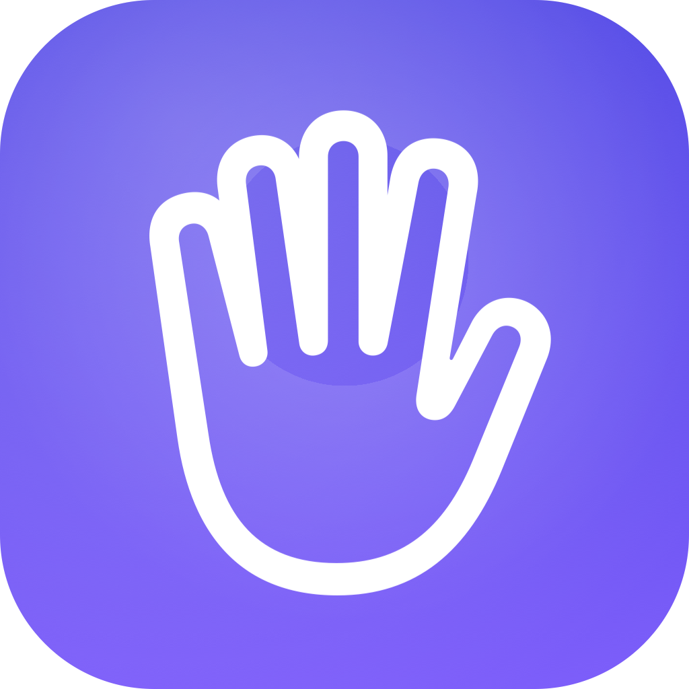

# 屏幕守卫 · ScreenGuard

> 一个基于视觉的 macOS 小工具：当检测到有手正在靠近屏幕时，弹出一张精致的悬浮卡片，提醒对方「请不要用手指触摸屏幕」。
>
> 全程本地识别，不联网、不上传、免第三方依赖。



---

## 目录

- [缘起](#缘起)
- [功能一览](#功能一览)
- [快速开始](#快速开始)
- [工作原理](#工作原理)
- [项目结构](#项目结构)
- [菜单选项](#菜单选项)
- [诊断快照](#诊断快照可删)
- [构建与开发](#构建与开发)
- [已知限制](#已知限制)
- [设计取舍](#设计取舍)
- [许可](#许可)

---

## 缘起

有些人的手，天生就管不住。看见一块亮晶晶的屏幕，就想伸出手指戳一下——戳完还理直气壮：「我就碰一下嘛」。

于是有了 ScreenGuard：一个坐在菜单栏里、默默盯着摄像头的小守卫。它不骂人、不弹系统通知、不打断你手头的事，只是在那只手**由远及近、真的在朝屏幕靠近**时，轻轻浮出一张卡片：

> **请不要用手指触摸屏幕**
> 给指尖留一点距离，让屏幕陪你更久。

### 一个恰逢其时的吐槽

讽刺的是，就在本项目开发期间（2026 年 10 月），苹果发布了**史上第一台带触摸屏的 MacBook Pro**——PROLED XDR 双层 OLED，支持十点触控，国行 22,999 元起，顶配拉满约 11.26 万元。触控传感器直接压进显示面板，官方宣传语里写着「手指与键鼠无缝配合」，评测里写着「十指直接弹琴、捏转 3D 模型」。

没怎么写的是另一件事：**这块屏幕，非常容易粘指纹。**

OLED 的镜面涂层配上天天上手戳的操作，结果就是一台「随手一摸就留下一片油光」的机器。以前 MacBook 用户最大的烦恼是「别人戳我的屏幕」，现在最大的烦恼变成了「我自己戳完还得擦」。我们从「防止别人触摸」进化到了「防止自己留指纹」，属于是人类科技树点在了一个奇怪的分叉上。

所以 ScreenGuard 现在的定位显得有点微妙：它拦的是**别人**的手，至于你自己那台新触控 MacBook 上的指纹——抱歉，这个得靠眼镜布。（如果你实在忍不了，本项目源码完全开源，欢迎 PR 一个「自动擦拭机械臂」模块。）

---

## 功能一览

| 特性 | 说明 |
| --- | --- |
| 视觉接近检测 | 基于 Apple Vision 框架，识别手部与上肢关键点，判断是否正在靠近屏幕 |
| 尺度增长门控 | 只有观察到手「持续变大」（由远及近）才报警，抬手、张手、静态悬停不误报 |
| 多姿态 / 多方向 | 不依赖单一手势，手掌、手臂、左右侧接近都能提供证据 |
| 精致悬浮卡片 | 深色玻璃质感 + 紫青渐变 + 脉冲光环 + 倒计时进度条，不抢焦点、不拦鼠标 |
| 三档灵敏度 | 保守 / 标准 / 灵敏，对应不同风险阈值 |
| 可调提醒间隔 | 3 / 5 / 8 / 12 秒冷却，避免频繁打扰 |
| 摄像头可选 | 自动 / 内置 / 外接 / 连续互通相机（iPhone） |
| 诊断快照 | 报警瞬间自动保存画面 + 数据，便于事后分析误报与漏报（可整体删除） |
| 完全本地 | 画面只在内存中实时分析；存储仅涉及本机诊断文件，不联网 |

---

## 快速开始

### 运行环境

- macOS 14.0 或更高版本
- 一台有摄像头的 Mac（内置 / 外接 / iPhone 连续互通相机均可）
- Xcode 命令行工具（`xcode-select --install`）

### 安装

```bash
git clone <本仓库地址>
cd windows/ScreenGuard
chmod +x build.sh
./build.sh
```

构建完成后会生成 `build/屏幕守卫.app`，双击即可运行。

```bash
open -a "build/屏幕守卫.app"
```

### 首次授权

首次启动时，系统会弹出相机权限请求，请选择**允许**。若误点了「拒绝」，请前往：

> 系统设置 → 隐私与安全性 → 相机 → 勾选「屏幕守卫」

应用启动后会常驻菜单栏，图标是一只手掌：`✋`（监测中）/ `🚫`（已暂停）。

> 说明：应用采用 ad-hoc 签名，Bundle ID 为 `com.workbuddy.screenguard`。若系统因迁移或重装重置了权限，重新授权一次即可。

---

## 工作原理

ScreenGuard 采用**五层检测流水线**，把「摄像头画面」逐步变成「要不要提醒」这个决定。

```
┌─────────────────────────────────────────────┐
│ Layer 1  视觉感知                              │
│  VNDetectHumanHandPoseRequest（最多 2 只手）     │
│  VNDetectHumanBodyPoseRequest（上肢）           │
└──────────────────┬──────────────────────────┘
                   ↓
┌─────────────────────────────────────────────┐
│ Layer 2  多目标追踪  HandTrackingEngine         │
│  跨帧最近邻关联 · 速度外推 · 轨迹平滑             │
│  尺度历史窗口（8 帧）· 丢失关键点 ≠ 丢失目标       │
└──────────────────┬──────────────────────────┘
                   ↓
┌─────────────────────────────────────────────┐
│ Layer 3  运动与意图分析                         │
│  方向 / 速度 / 姿态 / 区域 / 尺度增长 五类特征     │
└──────────────────┬──────────────────────────┘
                   ↓
┌─────────────────────────────────────────────┐
│ Layer 4  遮挡预测  OcclusionPredictor          │
│  短时匀速+加速度预测 · 置信度指数衰减             │
│  核心原则：手消失 ≠ 危险解除                     │
└──────────────────┬──────────────────────────┘
                   ↓
┌─────────────────────────────────────────────┐
│ Layer 5  风险决策  RiskEvaluator + 状态机        │
│  六特征加权评分 · 尺度增长硬门控 · 冷却 · 滞回    │
└─────────────────────────────────────────────┘
```

### 关键设计：尺度增长门控

这是整个系统最核心、也是迭代次数最多的一条规则：

> **只有观察到手部包围盒在连续多帧里持续变大，才允许报警。**

| 动作 | 尺度历史 | 是否报警 |
| --- | --- | --- |
| 手由远及近朝屏幕伸 | 面积连续多帧单调增长 | 报警 |
| 抬手 / 张开手掌 | 面积一次跳变后稳定 | 不报 |
| 手停在空中不动 | 面积基本不变 | 不报 |
| 手远离镜头 | 面积负增长 | 不报 |

实现上，`HandTrackingEngine.scaleGrowth(for:)` 检查最近 8 帧的包围盒面积：相对首帧增长超过 4%、且连续增长帧占比 ≥ 60% 时才输出正的增长强度；`RiskEvaluator` 再要求增长强度 ≥ 0.22 且连续 2 帧，才打开「门控」。门控是进入 `alert` 的**必要条件**——即使速度再快、姿态再像，门控不开也不会触发。

### 风险评分

六类特征加权求和，权重总和为 1：

| 特征 | 权重 | 含义 |
| --- | --- | --- |
| `growth` 尺度增长 | 0.32 | 手是否持续变大（核心前提） |
| `direction` 方向 | 0.20 | 运动是否朝向屏幕区域 |
| `velocity` 速度 | 0.14 | 接近运动的速度 |
| `gesture` 姿态 | 0.14 | 是否呈指向 / 张开手势 |
| `arm` 上肢伸展 | 0.12 | 肩肘腕是否呈伸手动作 |
| `zone` 空间区域 | 0.08 | 是否进入画面下方危险区（刻意压低） |

前置摄像头常拍不到完整上肢，此时 `arm` 特征恒为 0，评分逻辑会把它的权重按比例还给其余可靠特征，避免等效抬高触发阈值。

三档灵敏度对应的风险阈值：`保守 0.62` / `标准 0.48` / `灵敏 0.36`。

### 状态机

```
idle（待机）→ observing（观察中）→ approaching（接近中）
    → alert（已提醒）→ recovery（恢复中）→ idle
                 ↘ occluded（目标遮挡，非必经）
```

- 连续 3 帧满足门控 + 阈值才进入 `alert`（极强接近信号一帧记两票，两步即达，约 66ms）。
- 已报警后，手停住约 0.67 秒、或彻底失去遮挡证据，才解除提醒，避免卡片一闪而过。
- 视觉置信度与接触意图置信度刻意分离：「看得清」不等于「想触碰」。

---

## 项目结构

```
ScreenGuard/
├── Package.swift                          # SwiftPM 清单（macOS 14+，无外部依赖）
├── build.sh                               # 构建 + 打包 .app + ad-hoc 签名
├── Resources/
│   ├── Info.plist                         # 应用元数据、权限说明
│   ├── generate_icon.swift                # CoreGraphics 绘制 1024 图标源图
│   ├── build_icon.sh                      # iconset → AppIcon.icns
│   ├── AppIcon.icns                       # 成品图标
│   └── 图标预览.png                        # 图标预览图（README 配图）
├── Sources/ScreenGuard/
│   ├── main.swift                         # 应用入口、菜单栏、生命周期、调试通知
│   ├── HandProximityDetector.swift        # 协调者：编排采集与各检测模块，对外接口
│   ├── MenuContent.swift                  # 菜单栏设置界面
│   ├── OverlayManager.swift               # 悬浮提醒窗口 + 卡片视觉
│   ├── DiagnosticCapture.swift            # 诊断快照（独立、可删）
│   ├── Models/
│   │   └── DetectionModels.swift          # HandTrack / 状态 / 风险评估 / 特征集
│   └── Detection/
│       ├── HandPoseAnalyzer.swift         # 手部关键点、食指伸出、手掌张开
│       ├── BodyPoseAnalyzer.swift         # 上肢伸展度
│       ├── HandTrackingEngine.swift       # 多目标关联、轨迹平滑、尺度增长
│       ├── OcclusionPredictor.swift       # 遮挡期风险维持与衰减
│       ├── ScreenGeometry.swift           # 危险区归一化模型（可标定）
│       └── RiskEvaluator.swift            # 特征加权 + 状态机（可调参数集中处）
└── build/                                 # 构建产物（已加入 .gitignore）
    └── 屏幕守卫.app
```

**对外接口保持稳定**：`HandProximityDetector` 通过 `@Published` 状态和 `onTrigger` / `onClear` 回调与 UI 通信，未来替换检测算法无需改动 UI 层。

---

## 菜单选项

点击菜单栏手掌图标：

| 选项 | 说明 |
| --- | --- |
| 开启手势监测 | 总开关；关闭会停止摄像头并清空状态 |
| 检测强度条 | 实时显示当前风险与阈值的关系，橙粉色表示接近触发 |
| 信号标签 | `食指伸出` / `正在靠近` / `接近区`，显示哪一路信号在工作 |
| 灵敏度 | 保守 / 标准 / 灵敏 |
| 提醒间隔 | 3 / 5 / 8 / 12 秒 |
| 提示音 | 触发时的轻提示音（Tink）开关 |
| 摄像头 | 自动 / 内置 / 外接 / 连续互通相机 |
| 预览提醒 | 不依赖摄像头，先看一眼弹窗效果 |
| 诊断快照分区 | 开关、记录当前、打开文件夹、张数统计 |

---

## 诊断快照（可删）

这是为「调算法」准备的临时功能。报警瞬间自动落盘一张当时的摄像头画面与一份数据 JSON，便于把「误报 / 漏报」和当时的判断依据对上号。

- 文件位置：`~/Library/Application Support/ScreenGuard/Diagnostics/`
- 每次快照 = 同名 `PNG`（画面）+ `JSON`（数据）
- **自动快照**：报警触发时保存，用于分析误报
- **手动记录**：点「记录当前」，用于分析漏报（手戳了但没报）
- JSON 含：风险分、阈值、六类特征、双置信度、遮挡保留、门控状态、尺度历史、轨迹详情等

**如何整体删除**：删除 `DiagnosticCapture.swift`，移除 `HandProximityDetector`、`MenuContent.swift`、`main.swift` 中零星几处调用即可，其余功能不受影响。关闭菜单里的开关后不会产生任何磁盘写入。

---

## 构建与开发

```bash
cd ScreenGuard
./build.sh
```

脚本做了四件事：

1. `swift build --disable-sandbox -c release` 编译（关闭沙箱以适配本机环境）
2. 创建 `build/屏幕守卫.app` 的目录结构
3. 拷贝可执行文件、`Info.plist`、`AppIcon.icns`
4. `codesign --force --deep --sign -` 做 ad-hoc 签名

如需重新生成图标：

```bash
./Resources/build_icon.sh   # 需 macOS，依赖 sips / iconutil
```

### 常用调试通知

```bash
# 预览提醒弹窗（无需摄像头）
swift -e 'import Foundation; DistributedNotificationCenter.default().postNotificationName(NSNotification.Name("com.screenguard.preview"), object: nil, deliverImmediately: true)'

# 手动记录一帧诊断快照
swift -e 'import Foundation; DistributedNotificationCenter.default().postNotificationName(NSNotification.Name("com.screenguard.snapshot"), object: nil, deliverImmediately: true)'
```

### 可调参数

| 参数 | 位置 | 作用 |
| --- | --- | --- |
| `growthGate` / `growthFramesNeeded` | `RiskEvaluator.swift` | 增长门控松紧：误报多调高，漏报多调低 |
| 特征权重 `weights` | `RiskEvaluator.swift` | 各信号重要性 |
| 阈值三档 | `RiskEvaluator.swift` / `HandProximityDetector.swift` | 灵敏度档位对应阈值 |
| `maxMissedFrames` | `HandTrackingEngine.swift` | 遮挡预测最长保留帧数 |
| `predictionWindow` | `OcclusionPredictor.swift` | 遮挡风险预测窗口 |
| `dangerZoneTop` | `ScreenGeometry.swift` | 危险区位置（支持持久化标定） |
| 采样间隔 | `HandProximityDetector.swift` | 当前约 30fps（33ms） |

---

## 已知限制

**必须靠真机实测的：**

- **摄像头视野盲区**：MacBook 摄像头在屏幕上方朝向用户，手指从侧面、下方伸来，或已经贴到屏幕时，可能看不到。看不到就无法预警，这是物理限制。
- **光照与背景**：暗光、复杂背景、强逆光会影响 Vision 关键点置信度。
- **上肢特征**：前置摄像头通常只拍到半身，`armExtension` 在常见坐姿下经常为 0，已通过权重补偿缓解。

**明确还没做的（刻意保留，避免堆栈过多算法掩盖误报来源）：**

- 光流追踪（`VNGenerateOpticalFlowRequest` / `VNTrackObjectRequest`）
- Kalman 滤波（目前是匀速 + 加速度预测 + 指数衰减）
- 屏幕空间可视化标定向导（`ScreenGeometry` 有模型与持久化，无 UI）
- Core ML 手部目标检测模型（遮挡兜底）
- 真实三维深度估计（单目摄像头限制，目前用二维归一化坐标近似）
- 光照/背景鲁棒性、长时间功耗、多显示器按设备定位等专项测试

**未做的替代技术路线研究结论**（供参考）：Mac 全系无 LiDAR；环境光传感器刷新慢且易受光照干扰；声学声呐属研究原型；外接 ToF 深度传感器（如 VL53L5CX）是最靠谱的非视觉替代，但需外接硬件。

---

## 设计取舍

- **Dialog 不抢焦点**：`NSPanel` + `nonactivatingPanel` + `ignoresMouseEvents`，提醒不会打断游戏或视频。
- **层级克制**：窗口层级 `.floating`（3），不用 `.screenSaver`，不压过系统安全界面。
- **跟随鼠标所在屏幕**：多显示器下弹窗出现在你正在看的那块屏。
- **不叠材质**：悬浮卡片用纯色渐变而非 `.ultraThinMaterial`——透明窗口叠毛玻璃在 macOS 上会渲染出灰色方块（踩过坑）。
- **菜单栏不自定义圆角**：`MenuBarExtra` 的 `.window` 面板圆角由系统控制，强行自绘会出灰边 / 方角，保持原生最稳。

---

## 许可

本项目为个人学习与实践作品，可自由使用与修改。吐槽部分纯属调侃，无意冒犯任何厂商；关于触屏 MacBook 粘指纹的描述来自真实使用体验与公开评测。

> 最后的最后：如果你也是被戳屏幕的人，愿这张卡片替你说出那句不好意思开口的话。
> 如果你正是那个爱戳屏幕的人——嗯，至少现在你知道有人在看你了。
